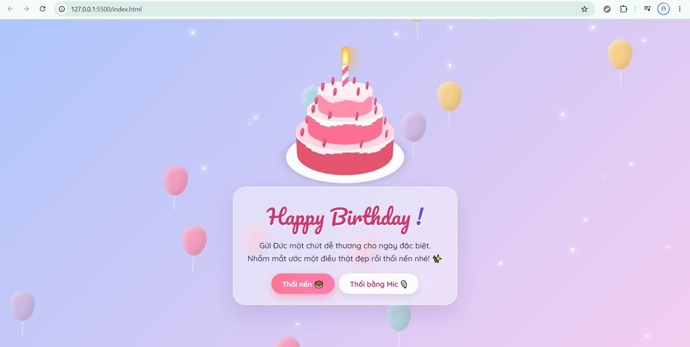

# Dự án Chúc Mừng Sinh Nhật (Happy Birthday)
Một trang web nhỏ xinh được làm bằng HTML, CSS và JavaScript dùng để gửi lời chúc mừng sinh nhật đến những người thân yêu.

## Tính năng nổi bật
* **Đếm ngược/Hiệu ứng:** (Ví dụ: Thổi nến, hiệu ứng pháo hoa, đập bóng bóng...)
* **Lời chúc:** Lời chúc ý nghĩa tự động xuất hiện với hiệu ứng gõ chữ (Typewriter).
* **Giao diện:** Thiết kế responsive, hiển thị đẹp mắt trên cả điện thoại và máy tính.
  
## Công nghệ sử dụng
* **HTML5** - Xây dựng cấu trúc trang web.
* **CSS3** - Thiết kế giao diện và các hiệu ứng chuyển động (Animation).
* **JavaScript (ES6)** - Xử lý logic tương tác (ví dụ: nút bấm thắp/thổi nến).
  
## Xem trực tuyến (Demo)
Bạn có thể xem trực tiếp trang web đang chạy tại đây:  
[Bấm vào đây để xem trang web](https://nguyennhat-it.github.io/happy-birthday/)

---
Phát triển bởi [nguyennhat-it](https://github.com) 

